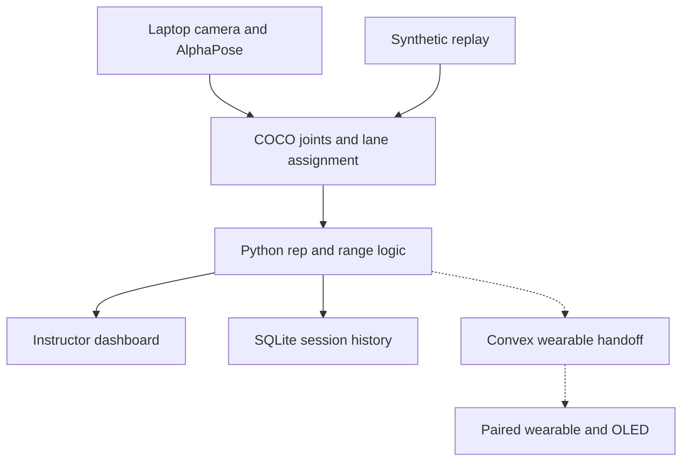

# CCCARE Exercise Tracker

ECE 198 · Fall 2026 · Progress demonstration for Nov. 11

CCCARE instructors may supervise 10–12 participants at once, or up to 30 in a graduated group. They need a practical way to see how much exercise each person completed and which participants could use a closer look. Participants need short, individualized cues. The project focuses on **Subproblem 2, exercise tracking and measurement**, with one piece of **Subproblem 1, scale personalized care**. The instructor sets a rep target per participant and can look up that participant's previous sessions.

## Start here

The dashboard now has a fixed exercise catalog: seated right-arm curls, pushups, squats, seated knee extensions, seated shoulder raises, seated marches, and sit-to-stand. Choose a station name and assign a numbered participant ID to each camera lane. End-of-session reports separate rep targets, range scores, tracking coverage, and review notes. See [exercise criteria](docs/EXERCISES.md) and the [frontend/API handoff](docs/FRONTEND_API.md). The original curl path has been tried live; the added exercises have synthetic/API checks and still need volunteer validation. There is no custom-angle editor.

Run `start-frontend.cmd` to install missing frontend dependencies, build the website, and start the Python app at [127.0.0.1:8000](http://127.0.0.1:8000). Open **Admin login**, enter any demo values, and choose **Prepare a session**. The Alder frontend now controls the real tracker API: exercise/station setup, one to five lane assignments, targets, live cues, SQLite history, and printable reports. Demo login is navigation only. The participant programme pages still contain clearly labeled illustrative records.

Once built, `python app.py` or `start-dashboard.cmd` serves the same integrated site without a Node server. The original dashboard remains at [/tracker](http://127.0.0.1:8000/tracker), and remains the homepage fallback if the frontend has not been built. For a camera-free trial, select **Synthetic demo replay**, then **End & save session** after five seconds. See the [frontend guide](frontend/README.md), [demo runbook](docs/RUNBOOK.md), and [wearable handoff](docs/WEARABLE.md).

## What the prototype does

The instructor starts one exercise session for up to five numbered participants, selects a camera or synthetic replay, assigns participant IDs to lanes, and sets one rep target per person. The dashboard shows completed attempts, target progress, whether the last attempt reached the selected exercise's demonstration range threshold, and specific tracking availability reasons. Finishing saves a report for each participant, including range score, observed peak angles, tracking coverage, and review notes. History keeps exercise, station, and target snapshots. A qualified instructor interprets the motion and sets the exercise plan.

The Nov. 11 checkpoint is a five-minute progress presentation. A five-person synthetic replay demonstrates the software flow, followed by one volunteer on the camera if the AlphaPose setup is ready. The course handout lists Nov. 23 for the Stream 8 final symposium and Nov. 25 for Stream 4. The December note is later than either course date.

## Stack and ownership

| Part | Stack and role | Owner |
| --- | --- | --- |
| Pose input | AlphaPose FastPose, 17 COCO keypoints, Python adapter | Leo with Eric D |
| Rep and range logic | Python, dot product and an angle-based state machine, one state per participant | Leo's integration baseline, Eric D owns exercise scoring refinement |
| Dashboard | Next.js/React static export, served by the local Python app; original HTML dashboard retained | Leo and frontend teammate |
| Session API and database | Python standard library HTTP and SQLite, same laptop | Leo |
| Wearable and binding | Arduino or verified Wi-Fi hardware, OLED, optional pulse sensor, manual device-to-participant pairing for the demo | Erik Zhu |
| Wearable feedback | Convex HTTPS contract for latest summaries and optional end-of-session sensor data | Jinay Patel, with Leo providing the laptop interface |
| End-to-end test | Ground-truth rep labels, one wearable when available | Eric D and team |

The laptop is the authority for one active session. The camera adapter assigns detections by fixed left-to-right camera lanes, and the instructor maps participant IDs to those lanes before starting. Participants stay in their assigned lanes for that session; IDs can be reused at later stations. The server computes counts and range cues. The browser reads current state, and SQLite saves completed results. The optional Convex handoff sends compact participant updates to the wearable over HTTPS; it does not currently store session history. The camera and scoring path stays on the laptop.

## Constraints and acceptance

- Spend at most CAD $50 and use existing or borrowed parts. The course lists one UNO R4 Minima, one OLED, and borrowable GY-MAX30102 and ADXL335 modules. Verify the actual display and Wi-Fi hardware before relying on color IDs or wireless delivery. The UNO R4 Minima itself lacks Wi-Fi. Use a numbered seat and manually pair the first device.
- Set up an existing laptop and fixed camera with the right shoulder, elbow and wrist visible. Participants follow simple spoken cues, and the instructor can use a browser. Labels work alongside color.
- Rep accuracy target is below 10% absolute count error against manual labels on a nonzero rep set. Form accuracy target is below 10% disagreement against instructor-labeled range cues on scored reps. Report occlusions separately.
- Scale target is five people tracked simultaneously on the camera with independent counts. Five synthetic participants exercise the software path. Camera capacity requires a separate test.
- Latency target is 100 ms from a captured frame that changes a cue to the visible dashboard update. Report median and 95th percentile on the actual laptop, separately from wearable delay. The targets require measurement before they can be claimed.
- Rehearse with teammates and numbered demo IDs. Track arm range, dose progress, and camera visibility. Camera frames and joint coordinates are not written to the session database.

## Build order for Leo

1. Start the dashboard and trace one simulated pose frame to one participant card. Learn the HTTP request and response shapes.
2. Open the scorer and work through one curl on paper. Compare a full range attempt, a shortened one, and an occluded arm.
3. Finish a session, restart the server and reopen History. Trace the relationship between participants, sessions and per-participant results.
4. Get AlphaPose working on one short test clip and the laptop camera. Run one volunteer before arranging five fixed seats.
5. Share the data contract with Erik and Jinay. Pair one numbered lane to one band and confirm the same rep and cue appear on both screens.

## References

- ECE 198 project overview, pages 1–4, and course parts list, page 1, supplied in the course project.
- [AlphaPose installation](https://github.com/MVIG-SJTU/AlphaPose/blob/master/docs/INSTALL.md), [inference examples](https://github.com/MVIG-SJTU/AlphaPose/blob/master/docs/GETTING_STARTED.md), and [COCO output format](https://github.com/MVIG-SJTU/AlphaPose/blob/master/docs/output.md).
- [Arduino UNO board comparison](https://support.arduino.cc/hc/en-us/articles/9350551575964-What-s-the-difference-between-UNO-R3-and-UNO-R4-boards).
- [Convex HTTP actions](https://docs.convex.dev/functions/http-actions).
