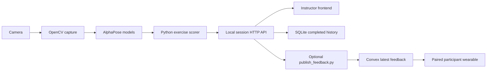

# Frontend handoff: stations, sessions, and reports

The frontend can be replaced independently of the pose code. The camera laptop runs `app.py`, computes scores, and exposes the HTTP contract below. Use numbered demo participant IDs; do not derive identities from skeleton detections.

## What runs where



AlphaPose estimates COCO keypoints. OpenCV supplies camera/video input and drawing; it does not replace AlphaPose's neural networks. Optional OpenVINO runs the same exported networks on Intel hardware. No OpenCV pose estimator was substituted.

The active session lives in Python memory. `POST /api/session/finish` saves it to SQLite, including exercise, station, participant IDs, target snapshots, range results, tracking coverage, review notes, and per-rep peak angles. A server restart retains completed history but clears an unfinished session.

The existing Convex implementation stores one latest-feedback snapshot, not session history. Its HTTP routes are `/feedback` on a `.convex.site` deployment. The current source allows optional exercise/station labels and IDs P01–P99, while still limiting the laptop session to five simultaneous lanes. Those Convex source updates require a deployment and have not been cloud-verified here. The relay uses separate publish/read tokens as documented in [WEARABLE.md](WEARABLE.md).

## Connecting a teammate's website

Leo's chosen path is to merge the simple frontend into this repository. Merge its HTML/CSS/JS into `web/index.html`, `web/style.css`, and `web/app.js`, keeping relative `/api/...` calls. The same Python app then serves both the frontend and session API at `http://127.0.0.1:8000`.

Use the endpoint/field contract below when connecting buttons, participant cards, and history views. If the frontend adds asset filenames, update the server's explicit asset list deliberately. The actual frontend merge is pending the teammate's source/branch; the separate AlphaPose performance branch should not be assumed to be that frontend.

The local frontend merge does not require moving session history from SQLite into Convex. Convex is currently the wearable feedback connection. Any later hosted station-control/history service would be a separate backend extension.

## HTTP contract

All POST bodies use `Content-Type: application/json`. Error responses have an `error` string and a non-2xx status. The default port is 8000 and the server binds IPv4 loopback.

| Request | Purpose |
| --- | --- |
| `GET /api/exercises` | Fixed exercise catalog, joint definitions, angle criteria, and five-lane capacity |
| `POST /api/session/start` | Start one exercise at one station, with a participant assigned to each lane |
| `GET /api/session` | Live state, or `{ "session": null }` |
| `POST /api/pose` | Camera/recording producer only; the frontend does not need to send poses |
| `POST /api/session/finish` | Save completed results; retrying the same ID returns its saved result |
| `GET /api/history` | Up to 30 recent completed sessions with reports |
| `GET /reports/<session_id>` | Standalone printable HTML report for a saved session; browser print supports saving as PDF |

Start example:

```json
{
  "source": "camera",
  "exercise": "squat",
  "station": "Station B",
  "participant_ids": ["P12", "P27"],
  "targets": [8, 10]
}
```

The first ID/target maps to the leftmost lane, and the second to the next lane. IDs must be unique P01–P99, with one to five targets between 1 and 99. Missing exercise, station, or IDs use the original curl/Station 1/P01… defaults for backward compatibility. Currently there is one active session per server process; a station label does not create simultaneous station servers.

The response contains `id`, `source`, `exercise`, `exercise_label`, `station`, `criteria`, timestamps, and `participants`. Each live participant contains:

```json
{
  "id": "P12",
  "label": "Participant 12",
  "lane": 1,
  "target": 8,
  "reps": 3,
  "full": 2,
  "short": 1,
  "last_range": "Short range",
  "angle": 161,
  "cue": "Check your range with the instructor",
  "tracking_reason": "Tracking",
  "range_score": 67,
  "tracking_coverage": 92,
  "tracking_losses": 1,
  "discarded_attempts": 1,
  "target_remaining": 5,
  "issues": ["1 attempt(s) did not reach the demo range target"],
  "rep_details": [{"number": 1, "peak_angle": 94.2, "reached_range": true}]
}
```

This abbreviated example illustrates field meanings; issue/rep-detail arrays in actual responses contain the complete session report. `angle` is null when the required pose is unusable. `tracking_reason` distinguishes low-confidence joints, a contested lane, no detection, invalid geometry, and a paused feed. Completed records omit current angle/cue/tracking reason but retain summary metrics and rep details.

The bridge accepts an increasing frame number and a pose or null per lane. It also sends `lane_counts` so no detection and multiple detections can be distinguished. The backend rejects a non-null pose paired with a detection count other than one.

Finish example:

```js
const response = await fetch('/api/session/finish', {
  method: 'POST',
  headers: { 'Content-Type': 'application/json' },
  body: JSON.stringify({ session_id: activeSession.id }),
});
const report = await response.json();
```

After saving, open `/reports/${report.id}` to review the workout. The current frontend opens the saved History entry and supplies an **Open workout report / print** link. The report uses saved results, including any incomplete dose or tracking issues; the prescribed target does not replace the actual count. Reports remain available after a server restart.

Poll active state about every 100–150 ms for the demo, prevent overlapping requests, and show reconnection status on errors. Rendering speed does not establish camera-to-screen latency. History can be fetched on demand. Numbered participant IDs stay with people across sessions; camera lane numbers do not.

## Thirty participants and feedback

Use a roster with stable IDs, and have the instructor assign each station's lanes before starting. Thirty people require rotating groups or additional tested camera/station capacity. This prototype does not recognize faces, follow people across stations, operate 30 camera lanes, or aggregate multiple active stations in one server process.

The current participant preview communicates a short cue plus rep progress. At the end, the report separates dose progress, the percentage of attempts reaching the configured range, and tracking problems. Review notes describe observed measurements; they do not diagnose a condition or claim every posture issue is detectable. Clinician/instructor-specific rehabilitation targets will be agreed with CCCARE later.

References: [Convex HTTP actions](https://docs.convex.dev/functions/http-actions), [OpenCV VideoCapture](https://docs.opencv.org/4.x/d8/dfe/classcv_1_1VideoCapture.html).
