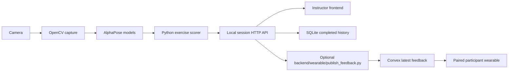

> Current architecture: Convex now archives sessions, people, attendance metrics and accepted AlphaPose frames. Frontend history and live feedback subscribe to Convex. SQLite is retained for recovery and durable upload retries. See [setup, data model and tests](REALTIME_ARCHITECTURE.md); older local-history descriptions below describe the compatibility path.

> Update: the SvelteKit frontend polls the tracker's `/api/session` for the live monitor and uses `/api/history` for local history; Convex (`feedback:live`, `archive:history`, `archive:personHistory`) is used when a read token is entered, and as the live source when the tracker is unreachable. See [current architecture and setup](REALTIME_ARCHITECTURE.md).

# Frontend handoff: stations, sessions, and reports

The frontend can be replaced independently of the pose code. The camera laptop runs `backend/tracker/server.py`, computes scores, and exposes the HTTP contract below. Use numbered demo participant IDs; do not derive identities from skeleton detections.

## What runs where



AlphaPose estimates COCO keypoints. OpenCV supplies camera/video input and drawing; it does not replace AlphaPose's neural networks. Optional OpenVINO runs the same exported networks on Intel hardware. No OpenCV pose estimator was substituted.

The active session lives in Python memory. `POST /api/session/finish` saves it to SQLite, including exercise, station, participant IDs, target snapshots, range results, tracking coverage, review notes, and per-rep peak angles. A server restart retains completed history but clears an unfinished session.

The optional publisher sends session and pose archive events to Convex `/archive` and the latest live snapshot to `/feedback`. The relay uses separate publish/read tokens as documented in [WEARABLE.md](WEARABLE.md). See [the archive architecture](REALTIME_ARCHITECTURE.md) for delivery and retry behavior.

## Connecting a teammate's website

The Next.js/React website and demo login pages live in `frontend/`. The Admin Panel reads and controls the local tracker with relative `/api/...` calls through `src/lib/tracker-api.ts` and `src/lib/use-tracker.ts`. It merges recent local reports with any shared Convex history. The participant portal reads individual results from Convex when configured.

Run `npm.cmd --prefix frontend ci` once, then `npm.cmd --prefix frontend run build`. Static export produces ignored `frontend/out/`. `python -m backend.tracker.server` serves the website and unchanged API together at `http://127.0.0.1:8000`; no CORS changes or second backend are needed. Direct page reloads, Next navigation data, fonts, images, and JS/CSS are served from that export only. `/tracker` retains the original dashboard. `scripts/start-frontend.cmd` automates build/start. Rebuild and refresh after editing React source.

The server launches the bridge when starting a camera session and closes its child process after saving. Closing the monitor keeps the session running. Targets edited in participant details apply to the next setup on that page, while started-session targets are saved as snapshots. Demo login fields are used for navigation only.

## HTTP contract

All POST bodies use `Content-Type: application/json`. Error responses have an `error` string and a non-2xx status. The default port is 8000 and the server binds IPv4 loopback.

| Request | Purpose |
| --- | --- |
| `GET /api/exercises` | Fixed exercise catalog, joint definitions, angle criteria, and five-lane capacity |
| `POST /api/session/start` | Start one exercise at one station, with a participant assigned to each lane |
| `POST /api/camera/retry` | Restart the managed bridge for the active camera `session_id`, retaining results |
| `GET /api/session` | Live state, or `{ "session": null }` |
| `POST /api/pose` | Camera/recording producer only; the frontend does not need to send poses |
| `POST /api/session/finish` | Save completed results; retrying the same ID returns its saved result |
| `GET /api/history` | Up to 30 recent completed sessions with reports |
| `GET /reports/<session_id>` | Standalone printable HTML report for a saved session; browser print supports saving as PDF |

Start example:

```json
{
  "source": "camera",
  "exercise": "squat",
  "station": "Station B",
  "participant_ids": ["P12", "P27"],
  "targets": [8, 10]
}
```

The first ID/target maps to the leftmost lane, and the second to the next lane. IDs must be unique P01–P99, with one to five targets between 1 and 99. Missing exercise, station, or IDs use the original curl/Station 1/P01… defaults for backward compatibility. Currently there is one active session per server process; a station label does not create simultaneous station servers.

The response contains `id`, `source`, `exercise`, `exercise_label`, `station`, `criteria`, timestamps, and `participants`. Managed live camera responses include `camera.state` and `camera.message`. Each live participant contains:

```json
{
  "id": "P12",
  "label": "Participant 12",
  "lane": 1,
  "target": 8,
  "reps": 3,
  "full": 2,
  "short": 1,
  "last_range": "Short range",
  "angle": 161,
  "cue": "Check your range with the instructor",
  "tracking_reason": "Tracking",
  "range_score": 67,
  "tracking_coverage": 92,
  "tracking_losses": 1,
  "discarded_attempts": 1,
  "target_remaining": 5,
  "issues": ["1 attempt(s) did not reach the demo range target"],
  "rep_details": [{"number": 1, "peak_angle": 94.2, "reached_range": true}]
}
```

This abbreviated example illustrates field meanings; issue/rep-detail arrays in actual responses contain the complete session report. `angle` is null when the required pose is unusable. `tracking_reason` distinguishes low-confidence joints, a contested lane, no detection, invalid geometry, and a paused feed. Completed records omit current angle/cue/tracking reason but retain summary metrics and rep details.

The bridge accepts an increasing frame number and a pose or null per lane. It also sends `lane_counts` so no detection and multiple detections can be distinguished. The backend rejects a non-null pose paired with a detection count other than one.

Finish example:

```js
const response = await fetch('/api/session/finish', {
  method: 'POST',
  headers: { 'Content-Type': 'application/json' },
  body: JSON.stringify({ session_id: activeSession.id }),
});
const report = await response.json();
```

After saving, open `/reports/${report.id}` to review the workout. The current frontend opens the saved History entry and supplies an **Open workout report / print** link. The report uses saved results, including any incomplete dose or tracking issues; the prescribed target does not replace the actual count. Reports remain available after a server restart.

Poll active state about every 100–150 ms for the demo, prevent overlapping requests, and show reconnection status on errors. Rendering speed does not establish camera-to-screen latency. History can be fetched on demand. Numbered participant IDs stay with people across sessions; camera lane numbers do not.

## Thirty participants and feedback

Use a roster with stable IDs, and have the instructor assign each station's lanes before starting. Thirty people require rotating groups or additional tested camera/station capacity. This prototype does not recognize faces, follow people across stations, operate 30 camera lanes, or aggregate multiple active stations in one server process.

The current participant preview communicates a short cue plus rep progress. At the end, the report separates dose progress, the percentage of attempts reaching the configured range, and tracking problems. Review notes describe observed measurements; they do not diagnose a condition or claim every posture issue is detectable. Clinician/instructor-specific rehabilitation targets will be agreed with CCCARE later.

References: [Convex HTTP actions](https://docs.convex.dev/functions/http-actions), [OpenCV VideoCapture](https://docs.opencv.org/4.x/d8/dfe/classcv_1_1VideoCapture.html).
