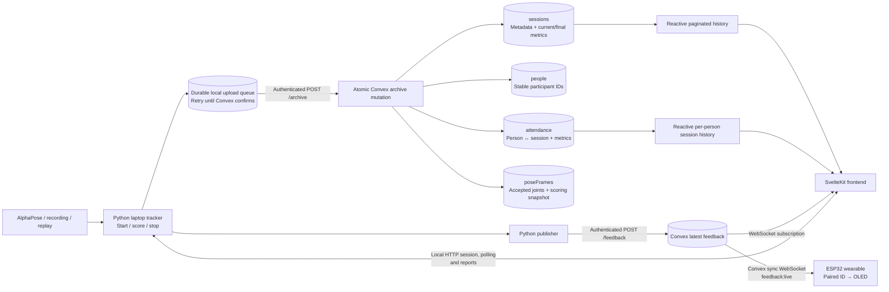

# Session archive and live feedback

Convex provides shared session history and participant feedback. The laptop starts AlphaPose and scores input when the instructor starts a camera session. The Admin Panel reads the laptop's active session and completed SQLite reports locally, and merges in shared archive history when Convex is connected. Each person's attendance links to their performance metrics.



All arrows are implemented. The ESP32 wearable (`ECE198-OLED-IMU/`) subscribes to `feedback:live` with the bundled C++ Convex client and has been verified on hardware against the cloud deployment `dev:trustworthy-jackal-8`. When the tracker serves the website, the live monitor and local history come from the tracker's own `/api/session` and `/api/history`, so the site works without Convex; with a read token entered, history and live feedback also come from Convex. A real local Convex backend has been used to test capture → upload → persistence → subscriptions.

## Data model

| Table | Purpose |
|---|---|
| `people` | One person per stable numbered ID, P01–P99; independent of their camera lane. |
| `sessions` | One record per start/stop session: source, exercise, station, timestamps, status and latest/final snapshot. |
| `attendance` | One person/session pair, with that person's targets, reps, full/short counts, range score, tracking coverage/losses, discarded attempts, issues and per-rep angles. Indexed for a person's attendance history. |
| `poseFrames` | Each accepted camera/recording frame: frame number, lane-assigned COCO joint coordinates/confidences (or missing pose), optional lane detection counts, and scoring snapshot. These survive session completion. |
| `feedback` | The latest live feedback and dashboard snapshot. Overwritten as feedback changes; not used as historical storage. |

History queries use pagination. Personal history returns only the selected person's result within each session, including current sessions. Completed group history excludes active sessions. Raw frame history is available through the authorized, paginated `archive:frames` query.

The tracker archives every accepted AlphaPose input frame, not just the 250 ms publisher sample. Duplicate/out-of-order frames rejected by the tracker do not become extra records. These are the lane-assigned inputs the scorer receives; camera video, original detector boxes and detections discarded by lane assignment are not sent by the existing bridge. Replay stores session snapshots as it advances, rather than raw camera frames. The current UI starts one exercise/station per session.

## Capture, retries and migration

Start, accepted pose updates and stop write durable upload events. Session IDs and event IDs survive retries. The publisher drains `/api/convex/pending`, sends each event to Convex `/archive`, and acknowledges locally only after Convex commits. A failed upload or lost acknowledgement leaves the event available for retry. Convex deduplicates frames and rejects older state overwriting newer/final metrics. Session, people and attendance changes commit in one Convex transaction.

SQLite provides local reports and a durable upload queue. Completed local reports and their pending upload events commit together. Existing SQLite reports are automatically queued for one-time import on server startup, including records older than the local history endpoint's 30-row limit. Older reports preserve the data originally recorded; missing old raw frames cannot be reconstructed. Keep the same `--db` file while syncing so pending uploads are retained.

A quick session that starts and stops between publisher polls is still archived. If the network is down, it remains queued; it appears in Convex history after upload succeeds. `/api/convex/status` reports `pending` and `dead_letter` counts. The publisher uploads archive events in batches of up to 100 (`POST /archive` with `{"events": [...]}`, applied atomically) on its own thread, so archive backlog never delays live feedback. Events Convex permanently rejects (4xx other than 401/429) are dead-lettered (kept in SQLite, logged with their eventId) so they cannot block the queue; network errors, 5xx, 429 and 401 are retried. A tracker restart does not re-upload sessions that were already finished or imported. Start/stop actions and exercise metadata stay local because the camera/scorer runs on the laptop. The legacy local history/report routes remain for compatibility/recovery. No existing local data is deleted. To roll back, stop the publisher and restore the previous frontend/backend; the original SQLite summaries remain readable.

An unexpected laptop shutdown retains queued data but does not restore the in-memory scoring counters. Such a session remains active in the archive until a recovery workflow is added; the live UI expires stale cues. Use the stop button to finalize ordinary sessions.

## Setup

1. Run `npm ci` at the root and in `frontend`. Link the team's cloud deployment with `npx convex dev`; deploy all functions/schema, including `archive.js`.
2. Fill root `.env`: `CONVEX_SITE_URL=https://YOUR-DEPLOYMENT.convex.site`, `FEEDBACK_PUBLISH_TOKEN`, and the team's deployment identifier as appropriate. Configure matching `FEEDBACK_PUBLISH_TOKEN` and `FEEDBACK_READ_TOKEN` in the Convex deployment using its dashboard or `npx convex env set`. Local env files do not set cloud function secrets. The CLI also maintains root `.env.local` for its deployment link; keep it pointed at the intended deployment.
3. Set `PUBLIC_CONVEX_URL=https://YOUR-DEPLOYMENT.convex.cloud` in `frontend/.env`. Do not put either token in a `PUBLIC_` variable. Rebuild after changing the public URL.
4. Run `./scripts/start-local.sh --build`. It loads root `.env` and automatically starts the publisher when the site URL and publish token are set. Otherwise it explicitly reports that uploads are queued locally. Stop with Ctrl+C. Alternatively, start the server and publisher separately:

   ```bash
   set -a
   source .env
   set +a
   python -m backend.wearable.publish_feedback --url "$CONVEX_SITE_URL"
   ```

5. Enter the read token in the frontend Connect form. It remains in memory. Start a camera/replay session, stop it, and check group history and the participant's session list. Data imported or uploaded later appears through subscriptions.

The prototype uses a shared read credential, granting access to the team's records; selecting a participant ID is not identity verification. Per-person login/authorization is not implemented. The future wearable must get a participant-scoped credential/query rather than the group dashboard feed.

## Tests

```bash
npm ci
npm --prefix frontend ci
npm test
npm run typecheck
npm --prefix frontend run check
npm --prefix frontend test
npm --prefix frontend run build
python -m unittest discover -s backend/tests -q
```

`npm test` runs Convex functions through `convex-test` with the real schema validators, plus contract tests (`tests/contracts.test.ts`) that feed real tracker/publisher payloads (`tests/tracker_events.py`) through the HTTP routes and check the function names/args the frontend uses. Frontend UI tests live in `frontend/src/tests` (`npm --prefix frontend test`). Firmware tests: `pio test -e native` and the hardware end-to-end test `ECE198-OLED-IMU/tools/e2e_test.py` (see `ECE198-OLED-IMU/README.md`). Generated Convex API files are included so unit tests do not require a deployment or login.

For the real integration test, start a disposable local `npx convex dev`, set its read/publish tokens to `local-test-read` / `local-test-publish`, then run `npm run test:live`. `CONVEX_TEST_URL` and `CONVEX_TEST_SITE_URL` override local addresses (defaults are ports 3210 and 3212; use the actual URLs in root `.env.local`). The script refuses non-loopback deployment URLs. It starts a temporary Python tracker, captures a session and raw frame, uploads with the actual publisher functions, checks WebSocket pushes/group history/personal history/raw frames/queue acknowledgement, and stops the tracker. Test sessions remain only in the disposable local backend.

## Wearable (ESP32)

Implemented in `ECE198-OLED-IMU/`. The board pairs with a participant ID, subscribes to `feedback:live` over the Convex sync protocol using the bundled C++ client (`src/convex`, see `ECE198-OLED-IMU/CONVEX_README.md`), shows reps/target, range score and cue on the OLED, and clears stale cues after 6 s without a relay update or on disconnect. It reconnects and re-subscribes after Wi-Fi or Convex connection loss. The latest-state subscription is not an event log: intermediate cue states may be skipped, while `poseFrames` preserves the accepted input history. The authenticated `GET /feedback?participant_id=P01` route remains as a polling fallback.

References: [JavaScript subscriptions](https://docs.convex.dev/client/javascript/overview), [Other languages / C++](https://docs.convex.dev/client/open-api).
