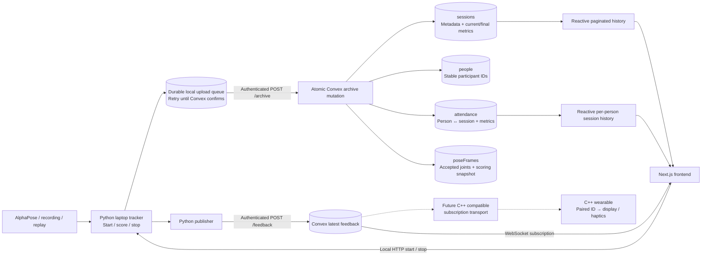

# Session archive and live feedback

Convex is the persistent session archive used by the frontend. Sessions start and stop using buttons; the laptop scores AlphaPose input. Each session has multiple people, and each person's attendance links to that session's complete performance metrics. Live wearable cues remain a separate, replaceable latest-state mailbox.



Solid arrows are implemented; dotted arrows are the future wearable integration. Cloud deployment and physical wearable delivery still require the team's configuration. A real local Convex backend has been used to test capture → upload → persistence → subscriptions.

## Data model

| Table | Purpose |
|---|---|
| `people` | One person per stable numbered ID, P01–P99; independent of their camera lane. |
| `sessions` | One record per start/stop session: source, exercise, station, timestamps, status and latest/final snapshot. |
| `attendance` | One person/session pair, with that person's targets, reps, full/short counts, range score, tracking coverage/losses, discarded attempts, issues and per-rep angles. Indexed for a person's attendance history. |
| `poseFrames` | Each accepted camera/recording frame: frame number, lane-assigned COCO joint coordinates/confidences (or missing pose), optional lane detection counts, and scoring snapshot. These survive session completion. |
| `feedback` | The latest live feedback and dashboard snapshot. Overwritten as feedback changes; not used as historical storage. |

History queries use pagination. Personal history returns only the selected person's result within each session, including current sessions. Completed group history excludes active sessions. Raw frame history is available through the authorized, paginated `archive:frames` query.

The tracker archives every accepted AlphaPose input frame, not just the 250 ms publisher sample. Duplicate/out-of-order frames rejected by the tracker do not become extra records. These are the lane-assigned inputs the scorer receives; camera video, original detector boxes and detections discarded by lane assignment are not sent by the existing bridge. Replay stores session snapshots as it advances, rather than raw camera frames. The current UI starts one exercise/station per session.

## Capture, retries and migration

Start, accepted pose updates and stop write durable upload events. Session IDs and event IDs survive retries. The publisher drains `/api/convex/pending`, sends each event to Convex `/archive`, and acknowledges locally only after Convex commits. A failed upload or lost acknowledgement leaves the event available for retry. Convex deduplicates frames and rejects older state overwriting newer/final metrics. Session, people and attendance changes commit in one Convex transaction.

SQLite now provides an upload queue and recovery copy; the frontend's session history comes from Convex. Completed local reports and their pending upload events commit together. Existing SQLite reports are automatically queued for one-time import on server startup, including records older than the legacy local history endpoint's 30-row limit. Older reports preserve the data originally recorded; missing old raw frames cannot be reconstructed. Keep the same `--db` file while syncing so pending uploads are retained.

A quick session that starts and stops between publisher polls is still archived. If the network is down, it remains queued; it appears in Convex history after upload succeeds. `/api/convex/status` reports pending event count. Start/stop actions and exercise metadata stay local because the camera/scorer runs on the laptop. The legacy local history/report routes remain for compatibility/recovery. No existing local data is deleted. To roll back, stop the publisher and restore the previous frontend/backend; the original SQLite summaries remain readable.

An unexpected laptop shutdown retains queued data but does not restore the in-memory scoring counters. Such a session remains active in the archive until a recovery workflow is added; the live UI expires stale cues. Use the stop button to finalize ordinary sessions.

## Setup

1. Run `npm ci` at the root and in `frontend`. Link the team's cloud deployment with `npx convex dev`; deploy all functions/schema, including `archive.js`.
2. Fill root `.env`: `CONVEX_SITE_URL=https://YOUR-DEPLOYMENT.convex.site`, `FEEDBACK_PUBLISH_TOKEN`, and the team's deployment identifier as appropriate. Configure matching `FEEDBACK_PUBLISH_TOKEN` and `FEEDBACK_READ_TOKEN` in the Convex deployment using its dashboard or `npx convex env set`. Local env files do not set cloud function secrets. The CLI also maintains root `.env.local` for its deployment link; keep it pointed at the intended deployment.
3. Fill `frontend/.env.local` with `NEXT_PUBLIC_CONVEX_URL=https://YOUR-DEPLOYMENT.convex.cloud`. Do not expose either token in `NEXT_PUBLIC_` variables. Rebuild after changing the public URL.
4. Run `./scripts/start-local.sh --build`. It loads root `.env` and automatically starts the publisher when the site URL and publish token are set. Otherwise it explicitly reports that uploads are queued locally. Stop with Ctrl+C. Alternatively, start the server and publisher separately:

   ```bash
   set -a
   source .env
   set +a
   python -m backend.wearable.publish_feedback --url "$CONVEX_SITE_URL"
   ```

5. Enter the read token in the frontend Connect form. It remains in memory. Start a camera/replay session, stop it, and check group history and the participant's session list. Data imported or uploaded later appears through subscriptions.

The prototype uses a shared read credential, granting access to the team's records; selecting a participant ID is not identity verification. Per-person login/authorization is not implemented. The future wearable must get a participant-scoped credential/query rather than the group dashboard feed.

## Tests

```bash
npm ci
npm --prefix frontend ci
npm test
npm run typecheck
npm --prefix frontend run typecheck
npm --prefix frontend run build
python -m unittest discover -s backend/tests -q
```

`npm test` runs Convex functions through `convex-test`, with the real schema validators, plus DOM tests for live subscriptions, stale expiry, cleanup, credential changes, history pagination, and individual performance rendering. Generated Convex API files are included so unit tests do not require a deployment or login.

For the real integration test, start a disposable local `npx convex dev`, set its read/publish tokens to `local-test-read` / `local-test-publish`, then run `npm run test:live`. `CONVEX_TEST_URL` and `CONVEX_TEST_SITE_URL` override local addresses (defaults are ports 3210 and 3212; use the actual URLs in root `.env.local`). The script refuses non-loopback deployment URLs. It starts a temporary Python tracker, captures a session and raw frame, uploads with the actual publisher functions, checks WebSocket pushes/group history/personal history/raw frames/queue acknowledgement, and stops the tracker. Test sessions remain only in the disposable local backend.

## Future C++ wearable

Pair firmware with a participant ID, receive their compact feedback, update the display/haptics, and clear stale cues after five seconds or disconnect. Reconnect/resubscribe after Wi-Fi loss. The latest-state subscription is not an event log: intermediate cue states may be skipped, while `poseFrames` preserves the accepted input history.

Convex has no first-party C++ client; HTTP/OpenAPI clients do not provide subscriptions. Choose a compatible sync client/transport for the board before implementing firmware. A generic WebSocket connection alone does not implement the Convex sync protocol. The existing authenticated `GET /feedback?participant_id=P01` remains a polling fallback. No firmware or additional transport bridge is implemented here.

References: [JavaScript subscriptions](https://docs.convex.dev/client/javascript/overview), [Other languages / C++](https://docs.convex.dev/client/open-api).
